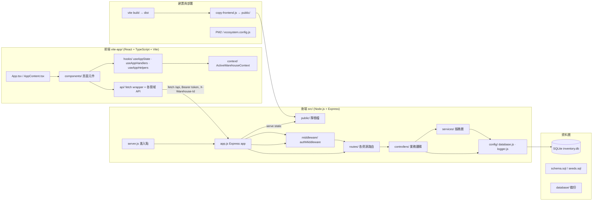
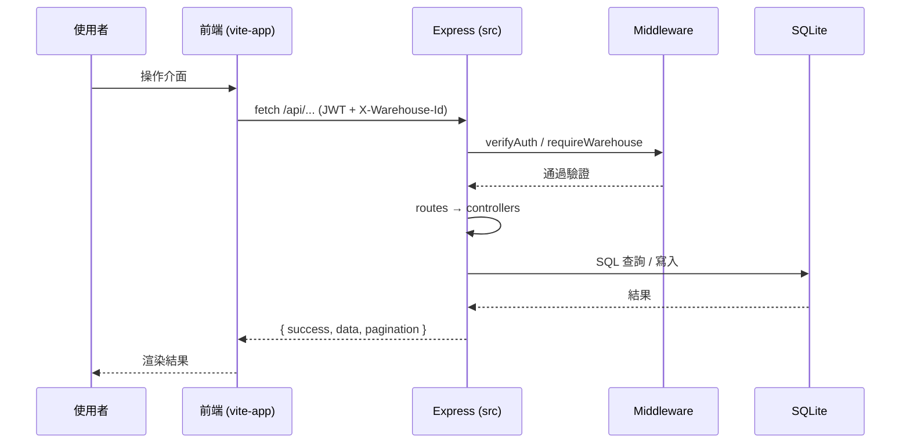

# 系統架構圖 (Architecture)

本文件以 Mermaid 描述目前 Inventory Management 系統的程式碼結構與資料流向。

## 架構總覽

## 分層說明

### 前端 (vite-app/)
- `App.tsx` / `AppContent.tsx`：應用外殼與視圖切換
- `components/`：各功能頁面（Dashboard、BatchFlow、AP 序號品、Shipments、Transactions 歷史、Reports、Audit Logs 等）
- `api/`：`client.ts` 統一 fetch wrapper，自動帶 `Authorization`（JWT）與 `X-Warehouse-Id`
- `hooks/`：`useAppState`、`useAppHandlers`、`useAppHelpers` 拆分狀態與行為
- `context/`：`ActiveWarehouseContext` 管理當前倉庫

### 後端 (src/)
- `server.js`：進入點，初始化 DB、啟動備份 daemon、graceful shutdown
- `app.js`：組裝 Express，掛載 middleware 與路由
  - 公開路由：`/api/health`、`/api/info`
  - 不需倉庫：`/api/auth`、`/api/warehouses`、`/api/users`、`/api/backup`
  - 需倉庫 context（`warehouseRouter`）：products、transactions、batches、shipments、tags、csv、product-units、audit-logs、reports
- `middleware/authMiddleware.js`：`verifyAuth`（JWT）、`requireRole`（admin/manager/view）、`requireWarehouse`
- `controllers/`：業務邏輯（Transaction Script 為主）
- `services/`：audit、auth、backup、quantityState、user、warehouse
- `config/`：database（含 migration）、logger（Winston）

### 資料層
- SQLite（WAL 模式），schema/seeds 位於 `database/`
- 自動備份機制

### 建置與部署
- `vite build` → `dist/` → `copy-frontend.js` 複製到 `public/`，由 Express 服務
- PM2（`ecosystem.config.js`）管理進程

## 主要請求流程

## 領域主要實體

- **Product（商品）**：SKU 唯一、有帳/無帳數量、min_stock、track_serial
- **Transaction（庫存異動）**：不可變歷史，記錄 quantity_change、quantity_type、tag、batch、shipment 關聯
- **AP / product_units（序號品）**：逐台追蹤 serial_number、status（in_stock / sold）
- **Shipment（出貨單據）**：`SHP-YYYYMMDD-XXX`，綁定多筆 Transaction
- **Warehouse / User / Role**：多倉庫隔離 + RBAC
